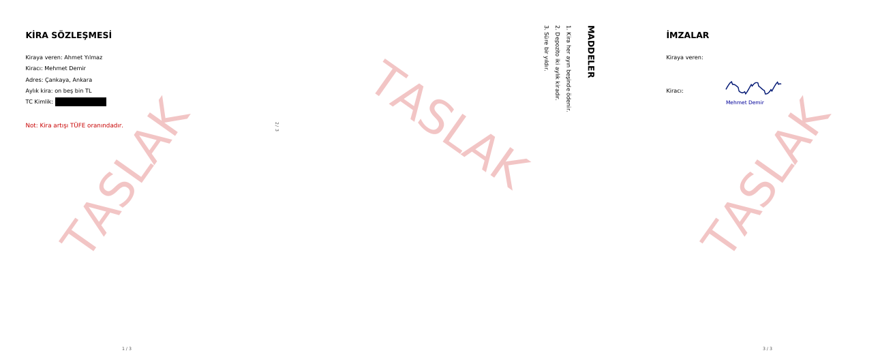

# Dönüştür — her şeyi her şeye (Android)

[Filee](https://filee.sh/tr/) benzeri, **internetsiz, reklamsız** Android dosya dönüştürücü, dosya açıcı ve PDF düzenleyici.

**İndir:** https://github.com/HAKANMAZI/ClaudeNotes/releases/tag/donustur-android

## v2: Aç ve düzenle (PDF, Word, Excel, metin)
- **📝 Aç ve düzenle** → dosya seç → türüne göre düzenleyici açılır. Dosyalar'da **Birlikte aç / Düzenle → Dönüştür** de olur.
- **Word (.docx):** paragrafa dokunup yaz, Enter yeni paragraf, paragraf ekle/sil, kalın, bul-değiştir. Stil, resim ve tablolar korunur.
- **Excel (.xlsx) / CSV:** hücreye dokunup değer ya da formül (`=SUM(A1:A5)`) yaz, sayfa sekmeleri, satır/sütun ekle, sütun toplamları. Hücre biçimleri korunur; formüller Excel'de açılınca hesaplanır.
- **Metin:** TXT, Markdown, JSON, HTML, XML, altyazı; bul-değiştir.
- **PDF:** PDF Düzenle ekranı (yazı, imza, karartma, sayfa işlemleri…).
- **Kaydet** asıl dosyanın üzerine yazar; izin yoksa İndirilenler/Donustur'a kopyalar. **Farklı kaydet**, **PDF olarak**, **Paylaş**.
- **➕ Yeni:** boş Word, Excel ya da metin belgesi.
- Eski .doc / .xls desteklenmez (.docx / .xlsx gerekir). Düzenlenen paragrafın içindeki karışık biçim (yarısı kalın gibi) ilk parçanın biçimine döner.

## Kullanım
- **📂 Dosya seç** → bir ya da çok dosya seç → hedef biçime dokun.
- Galeri / Dosyalar'da **Paylaş → Dönüştür** de çalışır.
- **👁 Dosya aç**: görsel, PDF, belge, ses, video, ZIP önizleme. "Birlikte aç → Dönüştür" da olur.
- Çıktılar: **İndirilenler/Donustur** klasörü. Bir dosya hata verirse diğerleri devam eder.

## Dönüşümler
| Tür | Biçimler | Araçlar |
|---|---|---|
| Görsel (JPG, PNG, WEBP, HEIC, AVIF, BMP, GIF) | JPG, PNG, WEBP, PDF, hepsi tek PDF | Döndür, aynala, siyah-beyaz, kırp 1:1 / 4:3 / 16:9, yarı boyut |
| PDF | JPG, PNG, TXT, tek PDF (birleştir) | Böl, küçült, sayfa numarası, **Düzenle** |
| DOCX, ODT, EPUB, PPTX | PDF, TXT | Office gerekmez |
| XLSX | CSV, JSON, HTML, PDF | |
| CSV / JSON | JSON / CSV, HTML, PDF, düzenli JSON | |
| TXT, Markdown, HTML, XML | PDF, HTML, TXT | |
| Altyazı | SRT ↔ WebVTT, TXT | |
| Video (MP4, MOV, MKV, WEBM, 3GP) | M4A, WAV, sessiz MP4, kare JPG | |
| Ses (MP3, M4A, AAC, FLAC, OGG, OPUS) | WAV, M4A | |
| Her şey | ZIP | ZIP'i aç |
| Karışık (görsel + PDF + belge) | Hepsi tek PDF | |

## PDF Düzenle
Sayfa küçük resimleri; dokunarak seç (seçim yoksa tümüne uygulanır):
döndür, sil, ayıkla, sırala (ör. `3,1,2,5-8`), ters çevir, PDF ekle,
**yazı ekle** (Türkçe karakter, boyut, renk, dokunduğun yere), **imza at** (parmakla),
resim/logo ekle, karart / beyazla (alan çiz), filigran, sayfa numarası,
şifrele, şifreli PDF'yi aç, başlık/yazar, küçült, metni al, **geri al** (15 adım), kaydet, paylaş.

## Sınırlar
- MP3'e çevirme yok (Android'de MP3 kodlayıcı yok) → M4A ya da WAV kullanın.
- Video sıkıştırma / HEVC yok; ses AAC değilse M4A yerine WAV seçin.
- "Karart" görünümü kapatır; alttaki metin dosyada kalır. Gizli bilgi için ardından "Küçült" (sayfayı resme çevirir) kullanın.
- DOCX/PPTX → PDF yazıyı aktarır, sayfa düzeni/resimler aktarılmaz.

## Derleme
GitHub Actions (`.github/workflows/donustur-android.yml`) her push'ta APK'yı derleyip sabit linke koyar.
Kotlin, minSdk 29 (Android 10+), PDF için [pdfbox-android](https://github.com/TomRoush/PdfBox-Android).

## Örnek
`ornek/ornek.pdf` → `ornek/ornek_duzenlendi.pdf`: yazı eklendi, TC kimlik karartıldı, TASLAK filigranı, sayfa numarası, 2. sayfa döndürüldü, imza atıldı.

