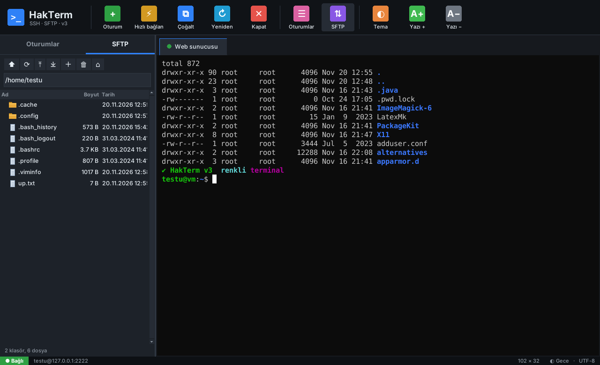

# HakTerm

MobaXterm benzeri, şık ve ücretsiz SSH + SFTP istemcisi (Python + Tkinter).

## Sürümler

| Klasör | Durum | İçerik |
|---|---|---|
| [v1](v1/) | Hazır | Kayıtlı oturumlar, sekmeli SSH terminali, SFTP dosya gezgini, hızlı bağlantı |
| [v2](v2/) | Hazır | v1 + renkler, vim/htop/top gibi tam ekran programlar, geçmişe kaydırma, güvenli yapıştırma |
| [v3](v3/) | Hazır | v2 + şık koyu arayüz, renkli araç çubuğu, oturum kartları, solda SFTP paneli, beş terminal teması |



## Hızlı başlangıç

```bash
cd v3
pip install paramiko pyte
python hakterm.py
```

En güncel sürüm v3'tür. v1 tek paketle (paramiko) çalışan daha sade sürümdür.
