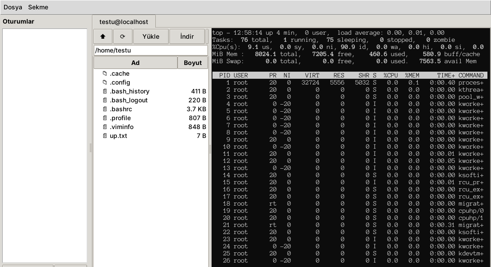

# HakTerm v2

MobaXterm benzeri, sade ve ücretsiz SSH + SFTP istemcisi (Python).



## v2'de yeni
- Gerçek terminal emülasyonu (pyte): renkler, kalın yazı, imleç
- vim, nano, htop, top, mc gibi tam ekran programlar düzgün çalışır
- vim'den çıkınca önceki ekran geri gelir (alternatif ekran)
- Geçmişe kaydırma: fare tekerleği veya Shift+PageUp / Shift+PageDown
- vim içinde tekerlek yukarı/aşağı kaydırır
- Yapıştırırken girinti bozulmaz (bracketed paste)

## Kurulum
```
pip install paramiko pyte
python hakterm.py
```

## Tek dosya .exe yapmak (Windows)
```
pip install pyinstaller
pyinstaller --onefile --windowed --name HakTerm hakterm.py
```
Çıktı: `dist\HakTerm.exe`

## Özellikler
- Kayıtlı oturumlar (sol panel)
- Sekmeli SSH terminali
- Her sekmede SFTP dosya gezgini: yükle, indir, klasör aç, sil
- Hızlı bağlantı: Ctrl+N → `kullanici@sunucu:port`
- Şifre veya SSH anahtarı ile giriş

## Kısayollar
- Sağ tık: seçili metni kopyala, seçim yoksa yapıştır
- Ctrl+Shift+C / Ctrl+Shift+V: kopyala / yapıştır
- Shift+PageUp / Shift+PageDown: geçmişte gezin
- Ctrl+W veya orta tık: sekmeyi kapat

Oturumlar `~/.hakterm_sessions.json` dosyasında tutulur. Şifreler kaydedilmez.
