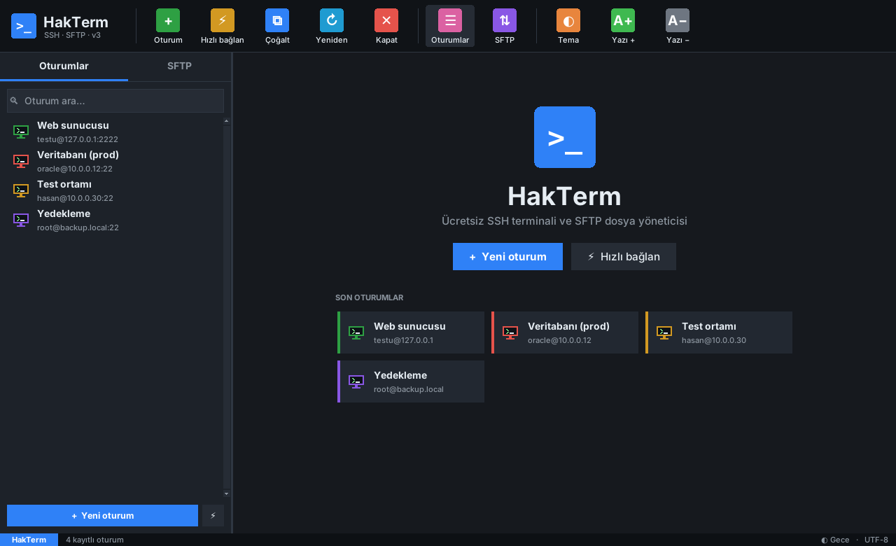
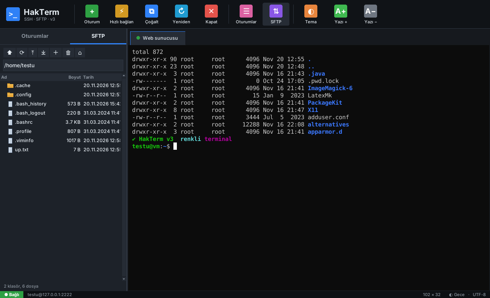
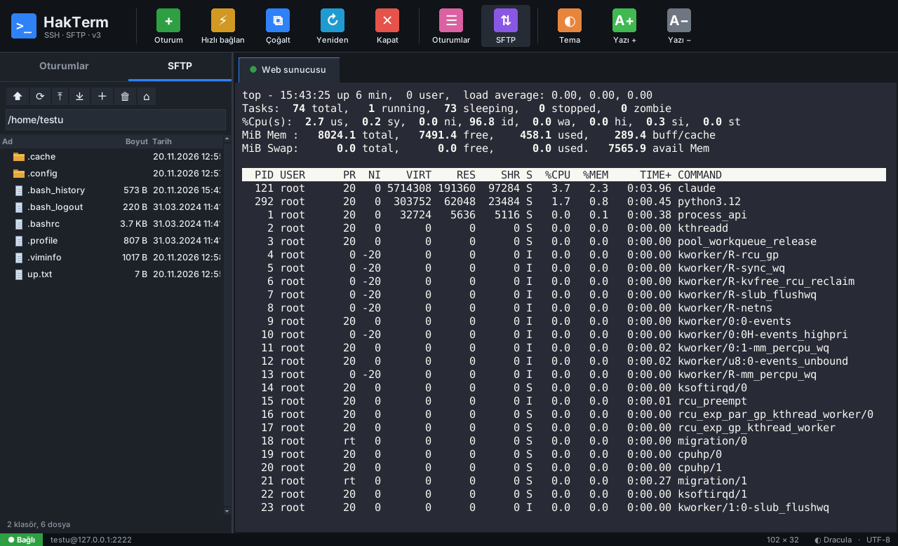

# HakTerm v3

MobaXterm benzeri, şık ve ücretsiz SSH + SFTP istemcisi (Python).





## v3'te yeni (görünüm)
- Koyu, modern arayüz
- Renkli simgeli üst araç çubuğu (MobaXterm şeridi gibi)
- Sol panelde renkli oturum kartları ve oturum arama
- Her oturuma renk seçebilme
- MobaXterm gibi solda SFTP paneli; bağlanınca otomatik açılır
- SFTP'de klasör/dosya simgeleri, boyut ve tarih, sağ tık menüsü
- "Terminali bu klasöre götür" butonu
- Açılış ekranında son oturumlar, tek tıkla bağlan
- Beş terminal teması: Gece, Dracula, Monokai, Solarized, One Dark
- Yazı büyüt / küçült (Ctrl + fare tekerleği)
- Sekmelerde renkli durum: yeşil bağlı, sarı bağlanıyor, kırmızı hata
- Sekmeye sağ tık: yeniden bağlan, çoğalt, kapat
- Renkli durum çubuğu, koyu pencereler, Windows'ta koyu başlık çubuğu
- Windows'ta net (bulanık olmayan) yazı

v2'deki her şey devam ediyor: renkler, vim/htop/top, geçmişe kaydırma, güvenli yapıştırma.

## Kurulum
```
pip install paramiko pyte
python hakterm.py
```

## Tek dosya .exe yapmak (Windows)
```
pip install pyinstaller
pyinstaller --onefile --windowed --name HakTerm hakterm.py
```
Çıktı: `dist\HakTerm.exe`

## Kısayollar
- Çift tık: oturuma bağlan
- Sağ tık (terminal): seçili metni kopyala, seçim yoksa yapıştır
- Ctrl+Shift+C / Ctrl+Shift+V: kopyala / yapıştır
- Shift+PageUp / Shift+PageDown: geçmişte gezin
- Ctrl+Shift+N: hızlı bağlan
- Ctrl+Shift+W veya orta tık: sekmeyi kapat
- Ctrl+Tab: sonraki sekme
- Ctrl + fare tekerleği: yazı boyutu

Oturumlar `~/.hakterm_sessions.json`, ayarlar `~/.hakterm_settings.json` dosyasında tutulur. Şifreler kaydedilmez.
